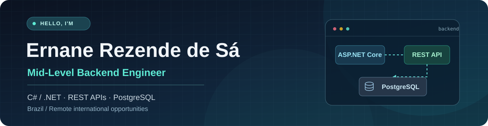

 

**Mid-level .NET backend developer · 5+ years of experience · Portuguese (native) · English C1 (EF SET 67/100)**

---

## 👋 A little about me

I'm a **mid-level backend engineer based in Brazil**, with 5+ years of professional experience building APIs, services, and integrations. **C#/.NET is my main stack**, and I've also worked with **Node.js and TypeScript** in professional projects.

I've contributed to systems in **insurance, fintech, e-commerce, and financial automation**. I enjoy the practical side of backend work: understanding the problem, making APIs and data flows predictable, troubleshooting issues, and leaving code that the next developer can maintain.

I'm **open to remote international Backend Engineer / .NET Developer opportunities**, full-time or contract. I'm looking to contribute as a **mid-level engineer** while continuing to grow with a collaborative team.

## 🧰 My toolkit

**My main focus**

**Also used in professional projects**

**How I work:** API design · database-backed services · integrations · asynchronous processing · code reviews · production troubleshooting · Clean Architecture and DDD practices

**Currently deepening:** AWS/Azure, observability, DevOps, distributed systems, and React/TypeScript. These are learning areas, not claims of senior-level expertise.

## 🚀 Featured work

These are public projects you can explore. They show different parts of my backend journey, from external API integration to testing and application design.

<table>
  <tr>
    <td width="50%" valign="top">
      <h3>🔌 <a href="https://github.com/ernanesa/MercadoBitcoin.Client">MercadoBitcoin.Client</a></h3>
      
<code>.NET</code> <code>C#</code> <code>API integration</code>

      
A typed .NET library for Mercado Bitcoin API v4, including asynchronous endpoints, resilience features, and WebSocket streaming.

      
<a href="https://www.nuget.org/packages/MercadoBitcoin.Client">View on NuGet ↗</a>

    </td>
    <td width="50%" valign="top">
      <h3>🦟 <a href="https://github.com/ernanesa/denguewatch">DengueWatch</a></h3>
      
<code>.NET 10</code> <code>MongoDB</code> <code>Docker</code>

      
An educational REST API for geolocated dengue case reports, with GeoJSON, JWT authentication, and containerized setup.

      
<a href="https://github.com/ernanesa/denguewatch">Explore the API ↗</a>

    </td>
  </tr>
  <tr>
    <td width="50%" valign="top">
      <h3>💳 <a href="https://github.com/ernanesa/CardBrandValidator">CardBrandValidator</a></h3>
      
<code>.NET 10</code> <code>xUnit</code> <code>REST + CLI</code>

      
Card-brand identification and Luhn validation, built as a bootcamp project with a reusable core and automated tests.

      
<a href="https://github.com/ernanesa/CardBrandValidator">See the tests and code ↗</a>

    </td>
    <td width="50%" valign="top">
      <h3>🏦 <a href="https://github.com/ernanesa/desafio01-ts">Dio Bank</a></h3>
      
<code>TypeScript</code> <code>OOP</code> <code>Vitest</code>

      
A learning project that models banking accounts and operations with object-oriented concepts and unit tests.

      
<a href="https://github.com/ernanesa/desafio01-ts">Explore the repository ↗</a>

    </td>
  </tr>
</table>

## 💼 Experience behind the projects

| Company | What I worked on |
| :--- | :--- |
| **Claps** · 2025–present | C#/.NET services, insurance workflows, gRPC, PostgreSQL, and partner integrations. |
| **Oba Hortifruti** · 2024 | .NET and Node.js integrations with VTEX, Salesforce, and internal systems. |
| **Itera** · 2022–2024 | .NET services, RabbitMQ, and workflows for financial automation. |
| **Warren Brasil** · 2021–2022 | Node.js/TypeScript APIs for a digital investment platform. |
| **ma9** · 2020–2021 | .NET backend services for financial and insurance systems. |

For full role descriptions and dates, visit my [LinkedIn profile](https://www.linkedin.com/in/ernane-rezende-de-sa/).

---

### 🤝 Let's build something useful

**Open to international remote opportunities as a Mid-Level Backend Engineer / .NET Developer.**

I'm happy to talk about backend engineering, integrations, and potential roles with international teams.

Learning, building, improving. One backend problem at a time.

